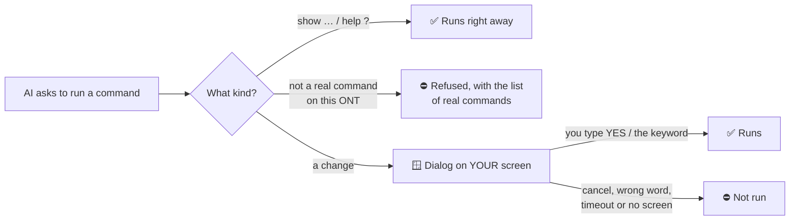

<div align="center">

# 🔦 digisol-mcp

### Talk to your fibre ONT in plain English.

**An [MCP](https://modelcontextprotocol.io) server that lets Claude, Cursor, VS Code and other AI assistants read and safely configure Digisol fibre ONTs.**

[](https://github.com/YOUR-USERNAME/digisol-mcp/actions/workflows/test.yml)


[](LICENSE)

[Quick start](#-quick-start-3-minutes) · [What you can ask](#-what-you-can-ask) · [Safety](#-safety-built-in-not-bolted-on) · [Configuration](#%EF%B8%8F-configuration) · [Troubleshooting](#-troubleshooting)

</div>

---

```text
You:     Why is my internet slow tonight? Check the fibre box.

Claude:  ▸ ont_show status
         ▸ ont_show wan

         Your ONT has been up for 18 hours and the WAN link is connected.
         PPPoE session is up and the default gateway answers, so the fibre
         line itself looks healthy. The slowdown is more likely on your Wi-Fi
         or router. Want me to check the DHCP table for unknown devices?
```

No web page with a captcha. No vendor app. No CLI manuals. **You ask, your assistant reads the ONT, you get an answer.**

## ✨ Why you'll like it

| | |
|---|---|
| 🧠 **Learns your ONT by itself** | Nothing is hardcoded. It asks your ONT's own CLI what it supports, so different models and firmware versions just work. |
| 🛡️ **You approve every change** | Reads are free. Every change pops up a dialog on *your* screen, and you have to type a word to allow it. The AI cannot click it for you. |
| 📦 **Zero dependencies** | One Python file, standard library only. No `npm install`, no Docker, nothing to break. |
| 🔐 **Your secrets stay yours** | Your ONT's IP and password live in *your* config: Keychain, a password file or env vars. Never in this repo. |
| 🏠 **Several ONTs** | Home, office, parents' house: one server, one config, pick by name. |
| 🐢 **Gentle on the hardware** | ONTs have tiny memory. Sessions are paced and short, so the box stays healthy. |

## 🚀 Quick start (3 minutes)

### 1 · Turn on SSH on your ONT

Open your ONT's web page (the address is on the sticker under the box, often `192.168.1.1`), find **Remote Access** (sometimes **Service Control**) and allow **SSH on the LAN side**. Then check it works from a terminal:

```bash
ssh admin@192.168.1.1
```

If you get a `>` prompt, you're good. Type `exit`.

> Got `no matching host key type`? Your ONT uses older SSH algorithms. Use the command in [Troubleshooting](#-troubleshooting).

### 2 · Store the ONT password safely

Pick **one**:

<details open>
<summary><b>🍎 macOS: Keychain (recommended)</b></summary>

```bash
security add-generic-password -s digisol-ont -a admin -w
```
It asks for the password and stores it encrypted. Then use `"ONT_KEYCHAIN": "digisol-ont"` below.
</details>

<details>
<summary><b>🐧 Linux: Secret Service (GNOME Keyring / KWallet)</b></summary>

```bash
secret-tool store --label="Digisol ONT" service digisol-ont user admin
```
Then use `"ONT_KEYCHAIN": "digisol-ont"` below.
</details>

<details>
<summary><b>📄 Any OS: a password file</b></summary>

```bash
mkdir -p ~/.config/digisol-mcp
printf '%s' 'YOUR-ONT-PASSWORD' > ~/.config/digisol-mcp/ont.password
chmod 600 ~/.config/digisol-mcp/ont.password
```
Then use `"ONT_PASSWORD_FILE": "~/.config/digisol-mcp/ont.password"` below.
</details>

### 3 · Add it to your AI app

You need Python 3.9+ (already on macOS and Linux). [`uv`](https://docs.astral.sh/uv/) is the easiest way to run it, with no clone and no install:

<details open>
<summary><b>Claude Desktop</b></summary>

Settings → Developer → Edit Config, then add:

```json
{
  "mcpServers": {
    "digisol": {
      "command": "uvx",
      "args": ["--from", "git+https://github.com/YOUR-USERNAME/digisol-mcp", "digisol-mcp"],
      "env": {
        "ONT_HOST": "192.168.1.1",
        "ONT_KEYCHAIN": "digisol-ont"
      }
    }
  }
}
```
Restart Claude Desktop.
</details>

<details>
<summary><b>Claude Code</b></summary>

```bash
claude mcp add digisol --scope user \
  -e ONT_HOST=192.168.1.1 -e ONT_KEYCHAIN=digisol-ont \
  -- uvx --from git+https://github.com/YOUR-USERNAME/digisol-mcp digisol-mcp
```
</details>

<details>
<summary><b>Cursor</b> (<code>~/.cursor/mcp.json</code>) and <b>Windsurf</b></summary>

Same JSON as Claude Desktop, under `"mcpServers"`.
</details>

<details>
<summary><b>VS Code</b> (<code>.vscode/mcp.json</code>)</summary>

```json
{
  "servers": {
    "digisol": {
      "command": "uvx",
      "args": ["--from", "git+https://github.com/YOUR-USERNAME/digisol-mcp", "digisol-mcp"],
      "env": { "ONT_HOST": "192.168.1.1", "ONT_KEYCHAIN": "digisol-ont" }
    }
  }
}
```
</details>

<details>
<summary><b>No uv? Use plain Python</b></summary>

```bash
git clone https://github.com/YOUR-USERNAME/digisol-mcp
```
Then use `"command": "python3"` and `"args": ["/full/path/to/digisol-mcp/digisol_mcp.py"]`.
(On Windows: `"command": "python"`.)
</details>

### ✅ Check it

```bash
ONT_HOST=192.168.1.1 ONT_KEYCHAIN=digisol-ont uvx --from git+https://github.com/YOUR-USERNAME/digisol-mcp digisol-mcp --check
```

```text
• ont  admin@192.168.1.1:22
  ✓ logged in. CLI commands: backup, config, debug, exit, help, reboot, restore, show
```

That's it. Ask your assistant *"What's the status of my ONT?"* 🎉

## 💬 What you can ask

| Ask | What happens |
|---|---|
| *"Is my fibre connection up? What's the WAN IP?"* | reads `status` and `wan` |
| *"Which devices are on my network right now?"* | reads `arp` and `dhcp` |
| *"Is Telnet open on my ONT? It shouldn't be."* | reads `remoteaccess`, then offers to close it (you approve) |
| *"Forward port 8080 to my home server at 192.168.1.50"* | explores `config portforward ?`, proposes the command, **asks you** |
| *"What firmware am I running?"* | reads `status` |
| *"Explain my ONT's routing table like I'm five"* | reads `route` and explains it |
| *"Reboot the ONT"* | dialog: you must type **REBOOT** |

## 🛡️ Safety: built in, not bolted on

Your ONT is the only thing between your home and the internet. This server treats it that way.



- **Human approval for every change.** The dialog shows the ONT, the exact command, the risk and the AI's reason. The AI cannot see or answer it.
- **Stronger lock on dangerous commands.** For `reboot`, `reset`, `restore`, firmware, WAN/LAN/PPP/VLAN, accounts and remote access, you must type the word itself (`REBOOT`, `WAN`, …), not just `YES`.
- **Read-only mode.** Set `"read_only": true` (or `ONT_READ_ONLY=1`) and changes are off completely. Great for a parent's ONT.
- **Only real commands.** Anything your ONT's CLI doesn't list is refused before it reaches the box.
- **One command per call.** Line breaks and control characters are rejected, so nothing can sneak in a second command.
- **No dialog, no change.** On a headless server, changes are simply refused.

Approval dialogs use AppleScript on macOS, PowerShell on Windows, and `zenity` or `kdialog` on Linux.

## ⚙️ Configuration

Your ONT details are **never** in this repo. Give them to the server in one of two ways.

### One ONT: environment variables

Put these in the `env` block of your AI app's config:

| Variable | Default | What it is |
|---|---|---|
| `ONT_HOST` | **required** | ONT IP address, e.g. `192.168.1.1` |
| `ONT_USER` | `admin` | SSH username |
| `ONT_PORT` | `22` | SSH port |
| `ONT_KEYCHAIN` | | Keychain (macOS) / Secret Service (Linux) entry name |
| `ONT_PASSWORD_FILE` | | Path to a file holding only the password |
| `ONT_PASSWORD` | | The password itself (easiest, least safe) |
| `ONT_LABEL` | `Digisol ONT` | Friendly name shown in approval dialogs |
| `ONT_READ_ONLY` | off | `1` turns off all changes |
| `ONT_PROMPT` | `> or #` | Regex for the CLI prompt, only if yours is unusual |

### Several ONTs: a JSON file

Copy [`ont.example.json`](ont.example.json) to `~/.config/digisol-mcp/ont.json` (found automatically) or anywhere you like and point `ONT_CONFIG` at it:

```json
{
  "default": "home",
  "devices": {
    "home":   { "host": "192.168.1.1",  "keychain": "digisol-home", "label": "Home ONT" },
    "office": { "host": "192.168.10.1", "password_file": "~/.config/digisol-mcp/office.password",
                "read_only": true }
  }
}
```

Device fields: `host`, `user`, `port`, `label`, `keychain`, `password_file`, `password`, `read_only`, `prompt`. A typo such as `pasword` is reported clearly instead of failing silently.

The tools then take a `device` argument: *"check the office ONT"*.

## 🧰 Tools

| Tool | Does | Approval |
|---|---|---|
| `ont_show` | `show <item>`: status, wan, lan, arp, dhcp, route, … | never |
| `ont_help` | asks the CLI what exists under a path (`config wan ?`) | never |
| `ont_run` | any change: `config …`, save, reboot, … | **always** |

## 📟 Compatibility

| ONT | Firmware | Status |
|---|---|---|
| Digisol **DG-GR6011** (EPON) | V1.0.00-240813 | ✅ Tested on real hardware |
| Other Digisol GPON/EPON ONTs with an SSH CLI | | 🟡 Should work, since the server learns the CLI. [Tell us!](CONTRIBUTING.md) |
| Other Realtek-based ONTs with the same CLI | | 🟡 Probably works. Please report. |

**Got a different model working?** Open an issue with the model name and the output of `--check`. It takes 2 minutes and helps everyone. ❤️

## 🩺 Troubleshooting

| You see | Fix |
|---|---|
| `wrong username or password` | Check the password in your keychain/file. The SSH login is usually the same as the web login. |
| `SSH is off on the ONT` | Enable SSH under Remote Access in the ONT web page. |
| `the ONT did not answer` | Wrong IP, or this computer isn't on the ONT's network (for example, it's behind another router). |
| `no matching host key type` when testing by hand | `ssh -o HostKeyAlgorithms=+ssh-rsa -o PubkeyAcceptedAlgorithms=+ssh-rsa admin@192.168.1.1`. The server already does this. |
| `the ONT's SSH key changed` | Expected after a factory reset or firmware update: `ssh-keygen -R 192.168.1.1` |
| `no approval dialog could be shown` | Linux: install `zenity` or `kdialog`. Headless machines can only read, by design. |
| `no ONT configured` | Set `ONT_HOST` in your AI app's `env` block, or create `~/.config/digisol-mcp/ont.json`. |
| The first answer takes ~10 s | Normal: on first use it learns your ONT's commands, and sessions are paced to protect the box. |

Still stuck? Run `digisol-mcp --check` and paste the output into an issue.

## ❓ FAQ

<details>
<summary><b>Why SSH and not the web page?</b></summary>

The web login has a captcha, and the pages load the ONT's small memory heavily. The SSH CLI is fast, scriptable and gentle.
</details>

<details>
<summary><b>Can the AI change settings without me knowing?</b></summary>

No. Every change waits for a dialog on your screen that only a person can answer. With `read_only`, changes are off completely.
</details>

<details>
<summary><b>Where is my password sent?</b></summary>

Only to your ONT, over SSH, on your local network. The server hands it to `ssh` through a private, one-shot helper. It's never logged, never in tool output, never sent to the AI.
</details>

<details>
<summary><b>Does it work with optical power (Rx/Tx dBm) readings?</b></summary>

Only if your ONT's CLI exposes them. Many firmwares show them only in the web page. Ask your assistant to run `ont_help` and see what your box offers.
</details>

<details>
<summary><b>Is this made by Digisol?</b></summary>

No. It's an independent open-source project, not affiliated with or endorsed by Digisol. "Digisol" is a trademark of its owner.
</details>

## 🤝 Contributing

Device reports, bug fixes and docs are all welcome: see [CONTRIBUTING.md](CONTRIBUTING.md).

```bash
python3 -m unittest -v      # offline tests, no ONT needed (includes a fake ONT over a real SSH flow)
```

## ⚠️ Disclaimer

Changing ONT settings can cut your internet, voice or IPTV, and may break your provider's terms. You approve every change; you own the result. Provided under the [MIT License](LICENSE), with no warranty.

<div align="center">

**If this saved you a trip to a captcha-protected web page, a ⭐ helps others find it.**

</div>
